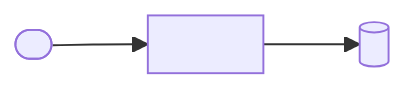
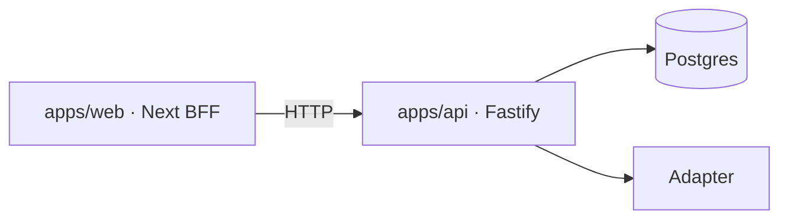

# Arquitetura — <produto>

## Contexto (C4 nível 1)

## Contêineres (C4 nível 2)

## Camadas da API
`routes` (fino: valida entrada, chama service, mapeia erro) → `services` (caso de uso, orquestra) →
`domain` (regra pura, sem I/O) · `repositories` (SQL) · `adapters` (sistemas externos). Ver skill `padroes`.

## Módulos por domínio
| Módulo | Responsável por | Funcionalidades |
|---|---|---|
| `<pedidos>` | … | F-001, F-002 |

## Integrações
| Sistema | Adapter | Timeout | Retry | Idempotência | Falha vira |
|---|---|---|---|---|---|

## Ambientes e hospedagem
| Ambiente | Onde | Deploy |
|---|---|---|
| dev | local (docker compose) | — |
| prod | <runtime de containers do ADR> | <merge na main → registry :sha → revisão nova + smoke /ready> |
