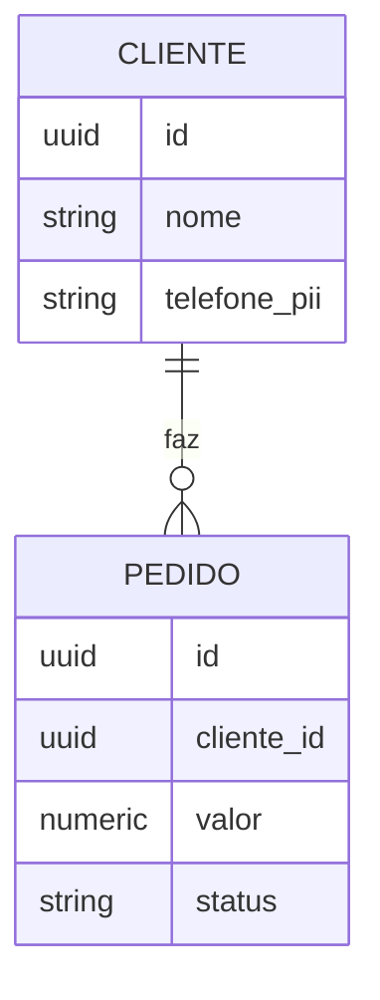

# Modelo de dados

## Mapa de nomes
Termo do negócio (spec, glossário) → identificador no código (inglês), usado em tabela, rota e tipo.

| Termo | Identificador | Onde aparece |
|---|---|---|
| Agendamento | `appointment` | tabela `appointments`, rota `/appointments` |

## Tabelas
### `<tabela>`
| Coluna | Tipo | Nulo | Pessoal? | Origem (F/R) |
|---|---|---|---|---|

## Retenção e acesso
| Dado | Retenção | Quem lê | Quem escreve |
|---|---|---|---|
